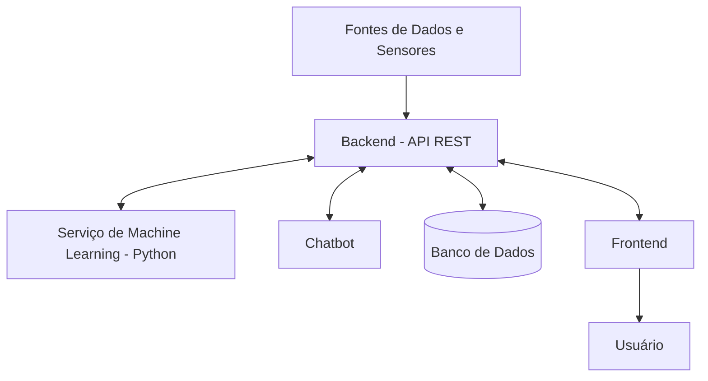

# Diagramas do Sistema

## 1. Objetivo

Apresentar visualmente a arquitetura e o fluxo de comunicação entre os componentes do Sistema Integrado de Segurança.

## 2. Arquitetura Geral

O sistema será dividido nos seguintes componentes:

- Frontend: interface de monitoramento.
- Backend: gerenciamento das regras de negócio e comunicação entre módulos.
- Chatbot: interação com os usuários.
- Machine Learning: análise e classificação de dados.
- Banco de Dados: armazenamento das informações.

## 3. Fluxo de Funcionamento

1. Os sensores ou fontes de dados fornecem informações ao sistema.
2. O Backend recebe os dados.
3. Quando necessário, o Backend solicita uma análise ao serviço de Machine Learning.
4. O serviço de Machine Learning retorna o resultado da análise.
5. O Backend registra a ocorrência e determina o tratamento adequado.
6. O Frontend apresenta as informações e os alertas.
7. O Chatbot pode fornecer informações complementares ao usuário.

## 4. Diagrama de Arquitetura

## 5. Observações

Os diagramas representam a arquitetura inicial proposta. Poderão ser atualizados conforme a equipe definir os detalhes técnicos e implementar os componentes.
